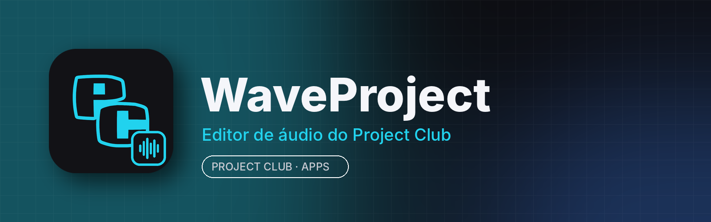

<p align="center"></p>

# WaveProject

**WaveProject** é o editor de áudio do **Project Club**: grave, corte, mixe e aplique efeitos em músicas, podcasts, vozes e sons — com a cara do Project Club e integrado à aba **Apps** do app para computador.

É baseado no **[Audacity®](https://www.audacityteam.org) 4** (código aberto, GNU GPL v3). Todos os recursos do Audacity continuam aqui; o WaveProject troca o nome, o ícone, o tema e a integração com o Project Club.

## Principais recursos

- Gravação de microfone e entrada de linha, com medidores de nível
- Edição multipista não destrutiva: cortar, copiar, colar, dividir e mover clipes
- Efeitos em tempo real (pilha de efeitos por faixa) e efeitos aplicados: equalizador, compressor, reverb, redução de ruído, normalizar, alterar tom/tempo e muitos outros
- Visualização em forma de onda e espectrograma
- Importa e exporta WAV, MP3, FLAC, OGG, AIFF, Opus e mais
- Plugins VST3, LV2 e Nyquist
- Projetos `.aup4` (abre também projetos `.aup3` do Audacity)
- Tema escuro do Project Club com destaque em ciano

## Instalar

Pelo **Project Club** (recomendado): aba **Apps → WaveProject → Instalar**. As atualizações chegam por lá.

Manual: baixe em [Releases](../../releases/latest):
- **Windows 10/11 (64 bits):** `WaveProject-<versão>-win.zip` → extraia e abra `bin/WaveProject.exe`
- **Linux (x86_64):** `WaveProject.AppImage` → `chmod +x WaveProject.AppImage && ./WaveProject.AppImage`

## Requisitos

| | Mínimo | Recomendado |
|---|---|---|
| Sistema | Windows 10 64 bits / Linux x86_64 (glibc 2.35+) | Windows 11 / Ubuntu 22.04+ |
| CPU | 2 núcleos, 2 GHz | 4 núcleos |
| RAM | 2 GB (o app usa ~250–500 MB) | 8 GB para projetos longos |
| GPU | OpenGL 3.3 / Direct3D 11 | qualquer GPU dedicada ou integrada recente |
| Disco | ~400 MB para o app + espaço dos projetos | SSD |

## Compilar

Igual ao Audacity 4 (veja [BUILDING.md](BUILDING.md)): CMake, Qt 6.10, compilador C++20.

```bash
git clone --recursive https://github.com/RiqueBitt/WaveProject
cd WaveProject
cmake --preset release && cmake --build --preset release
```

Para gerar os pacotes publicados no Project Club, rode o workflow **Build WaveProject release** (Actions → *Run workflow*, informando a versão). Ele compila Windows e Linux, tira as capturas de tela do app rodando e publica a release `vX.Y.Z`.

## O que muda em relação ao Audacity

- Nome, ícone, tela de abertura e “Sobre” do WaveProject (com os créditos ao Audacity)
- Tema escuro do Project Club (aplicado na primeira abertura; dá para trocar em Preferências)
- Atualizações pela aba Apps do Project Club (o verificador de atualizações do Audacity fica desligado) e sem envio de relatórios de falha

## Créditos e licença

WaveProject é uma versão modificada do **Audacity®**, © 1999-2026 Audacity Team, distribuída sob a **GNU General Public License v3** — veja [LICENSE.txt](LICENSE.txt). O nome Audacity® é marca registrada; o WaveProject não é afiliado nem endossado pela equipe do Audacity. O código-fonte completo, incluindo as modificações, está neste repositório. O README original está em [docs/README-Audacity-original.md](docs/README-Audacity-original.md).
